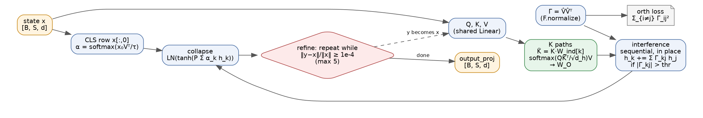
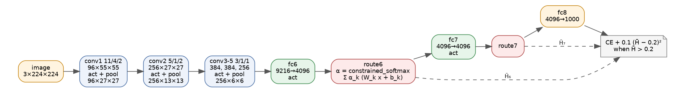
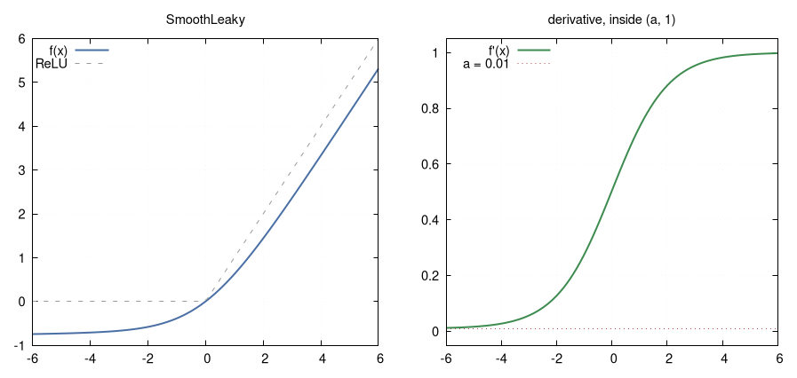
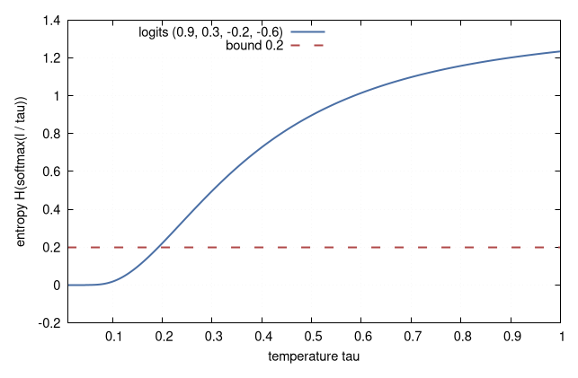

# superposition-induction-cuda

[](LICENSE)
[](https://developer.nvidia.com/cuda-toolkit)
[](https://en.cppreference.com/w/cpp/17)
[](CMakeLists.txt)
[](#gradient-checks)
[](Makefile)

A CUDA C++ port of two PyTorch models: the Superpositioned Induction Daemon, which
runs K induction-attention paths side by side, lets them interfere through the
overlap of their basis vectors and collapses them into one output that is refined
until it stops moving, and AlexNet-MMEP, an AlexNet whose ReLUs are SmoothLeaky
units and whose dropout is replaced by entropy-constrained routers. Both have their own
kernels for the forward and backward pass, a plain C++ reference they are tested
against, an optimizer step and a benchmark. There is no Python and no cuDNN. The
original PyTorch sources are kept verbatim in [docs/source-model.txt](docs/source-model.txt)
and [docs/source-alexnet-mmep.txt](docs/source-alexnet-mmep.txt).

## Superpositioned induction



The source describes the superposed weight as

$$
W_{\text{super}} = \sum_{k=1}^{K} \alpha_k \left(v_k v_k^{\top}\right) \otimes W^{\text{ind}}_k ,
\qquad
\alpha = \operatorname{softmax}\left(\frac{x_{\text{CLS}} V^{\top}}{\tau}\right)
$$

and what the code computes is one attention pass per path, with the keys bent by that
path's induction matrix:

$$
h_k = W_O \cdot \operatorname{softmax}\left(\frac{Q \left(K W^{\text{ind}}_k\right)^{\top}}{\sqrt{d_h}}\right) V .
$$

Paths interfere through the normalized basis overlaps:

$$
\Gamma_{ij} = \langle \hat v_i, \hat v_j \rangle, \qquad \hat v_i = \frac{v_i}{\max(\lVert v_i \rVert, 10^{-12})},
\qquad
h_k \leftarrow h_k + \sum_{j \ne k,\ |\Gamma_{kj}| > \theta} \Gamma_{kj}\, h_j ,
$$

applied for k = 1..K in order and in place, so later paths see the already-updated
earlier ones. The basis is pushed toward orthogonality by

$$
\mathcal{L}_{\text{orth}} = \sum_{i \ne j} \Gamma_{ij}^2 ,
$$

and the paths collapse to one output

$$
y = \operatorname{LN}\left(\tanh\left(W_c \sum_k \alpha_k h_k + b_c\right)\right).
$$

The block is applied again to its own output until
$\lVert y - x \rVert_F / (\lVert x \rVert_F + 10^{-8}) < 10^{-4}$ or five passes,
then goes through a final linear layer.

## AlexNet-MMEP



The five AlexNet convolutions and three fully connected layers are kept. Each ReLU becomes

$$
f(x) = a x + \frac{1-a}{b}\left(\operatorname{softplus}(b x) - \ln 2\right), \qquad f'(x) \in (a, 1),
$$

with a = 0.01 and b = 1. After fc6 and fc7, a router mixes K = 4 linear maps,
$\text{out} = \sum_k \alpha_k (W_k x + b_k)$, where α is a softmax whose temperature is
lowered by bisection, for rows whose entropy is over 0.2, until the entropy meets the bound.
Training is SGD (momentum 0.9, weight decay 5e-4) on

$$
\mathcal{L} = \operatorname{CE}(\text{logits}, y) + \sum_{\ell \in \{6, 7\}} 0.1\,(\bar H_\ell - 0.2)^2\,[\bar H_\ell > 0.2].
$$

<p>


</p>

## Build and run

You need CUDA 12 (nvcc and cuBLAS), CMake 3.20 or newer and a C++17 compiler.

```sh
make                       # builds for sm_80, sm_86, sm_89 and sm_90
make ARCHS="86"            # or just the card you have
make test                  # CPU tests, plus the GPU tests when a device is present
make bench                 # tokens/s and images/s on the GPU
make bench-cpu             # timings of the CPU references
```

Or with CMake directly:

```sh
cmake -S . -B build -DCMAKE_CUDA_ARCHITECTURES="80;86;89;90"
cmake --build build -j
cd build && ctest --output-on-failure      # -L cpu or -L gpu to pick a set
```

```sh
build/sid_init sid.skt && build/sid_run sid.skt --batch=2 --seq=16
build/amm_init amm.skt && build/amm_run amm.skt --batch=4
```

Weights use a small binary format described in [docs/weights-format.md](docs/weights-format.md),
with tensor names matching the PyTorch `state_dict` keys.

## Benchmarks

### CPU reference

Measured with `build/cpu_ref_bench` (best of 3, one thread, fp32, an Intel Xeon cloud VM, GCC 14.2.0 with -O3).
These are the plain loops the CUDA code is checked against, not tuned code. Superposition
runs on random inputs, so every case used all five refinement passes. The train step is the
forward pass, the backward pass and one AdamW or SGD update.

| case | shape | refine iters | forward | forward rate | train step | train rate |
| --- | --- | --- | --- | --- | --- | --- |
| sid d128 | B=4 S=64 | 5 | 105.0 ms | 2439 tok/s | 169.5 ms | 1510 tok/s |
| sid default-768 | B=1 S=64 | 5 | 577.6 ms | 111 tok/s | 923.2 ms | 69 tok/s |
| amm small-67 | N=8 67x67 | - | 1.6 ms | 4894.47 img/s | 4.8 ms | 1656.55 img/s |
| amm alexnet-224 | N=1 224x224 | - | 692.6 ms | 1.44 img/s | - | - |

`sid d128` is d 128, 4 paths, 4 heads of 32; `default-768` is the source config (d 768, 4 paths,
8 heads of 64). `small-67` is the test network with channels 4/6/8/8/6, fc 16, 3 routes;
`alexnet-224` is the full 196.7M-parameter model.

### GPU

The GPU code builds for sm_80, sm_86, sm_89 and sm_90, but no GPU was available where this
was written, so the GPU tests and benchmarks have not been run yet. These are the commands.
The last column is for your own measurements.

| command | what it reports | your GPU |
| --- | --- | --- |
| `build/sid_bench --batch=8 --seq=512` | forward and AdamW train tokens/s, d 768, 4 paths, 8 heads | |
| `build/sid_bench --batch=8 --seq=512 --tf32` | the same with TF32 GEMMs | |
| `build/sid_bench --batch=32 --seq=128` | shorter sequences, bigger batch | |
| `build/amm_bench --batch=64` | inference and SGD train images/s at 224x224 | |
| `build/amm_bench --batch=128 --tf32` | the same with TF32 GEMMs | |
| `build/amm_bench --batch=64 --image=227` | 227x227 input, same fc6 size | |

## Gradient checks

`sid_cpu_gradcheck` and `amm_cpu_gradcheck` compare the analytic backward pass of the CPU
references with finite differences, in double, for every parameter tensor and the input. A
tensor passes when its max relative error is at most 1e-5, or every element's absolute error
is under 1e-8 (superposition) or 1e-9 (AlexNet-MMEP). The relative error is taken per
element, so it gets large on elements whose true gradient is close to zero. That is why some
AlexNet-MMEP rows are above 1e-5 while their absolute error is around 1e-11. All tensors pass.

Superposition, worst over three configs (3 passes with 2 of 12 pairs interfering, an early
stop after 2 passes with 4 of 6 pairs interfering, and a single path):

| parameter | worst max rel. error | worst max abs. error |
| --- | --- | --- |
| `heads.path_basis` | 2.508e-08 | 3.780e-10 |
| `heads.W_induction` | 5.968e-07 | 3.877e-10 |
| `heads.W_Q.weight` | 9.262e-07 | 3.399e-10 |
| `heads.W_Q.bias` | 4.435e-08 | 2.607e-10 |
| `heads.W_K.weight` | 1.534e-06 | 2.715e-10 |
| `heads.W_K.bias` | true gradient ~0 (at most 1.8e-10) | 1.776e-10 |
| `heads.W_V.weight` | 3.071e-09 | 3.626e-09 |
| `heads.W_V.bias` | 3.112e-10 | 3.944e-10 |
| `heads.W_O.weight` | 2.674e-08 | 4.085e-10 |
| `heads.W_O.bias` | 4.571e-10 | 6.746e-10 |
| `heads.path_confidence` | not read, gradient 0 | 0 |
| `heads.collapse_proj.weight` | 5.029e-09 | 8.663e-10 |
| `heads.collapse_proj.bias` | 9.962e-09 | 9.326e-09 |
| `heads.ln.weight` | 6.820e-09 | 1.836e-10 |
| `heads.ln.bias` | 2.225e-09 | 2.606e-10 |
| `output_proj.weight` | 7.635e-09 | 8.855e-11 |
| `output_proj.bias` | 2.207e-09 | 7.321e-11 |
| `input x` | 1.408e-07 | 2.064e-10 |

AlexNet-MMEP on a 67x67 input with small channel counts. The three cases have rows being
bisected, the entropy penalty firing, and plain softmax. A cell reads "gradient ~0" where the
largest true gradient is under 1e-9.

| parameter | bisecting rows | penalty firing | plain softmax | worst max abs. error |
| --- | --- | --- | --- | --- |
| `conv1.weight` | 4.132e-06 | 4.843e-05 | 1.335e-05 | 2.534e-11 |
| `conv1.bias` | 6.540e-07 | 1.273e-06 | 3.060e-06 | 2.027e-11 |
| `conv2.weight` | 1.273e-05 | 1.818e-06 | 2.393e-06 | 2.575e-11 |
| `conv2.bias` | 5.706e-06 | 6.867e-06 | 7.918e-06 | 4.357e-11 |
| `conv3.weight` | 9.736e-06 | 1.006e-04 | 1.002e-04 | 3.374e-11 |
| `conv3.bias` | 9.250e-08 | 1.596e-07 | 1.982e-06 | 1.897e-11 |
| `conv4.weight` | 6.609e-06 | 1.127e-05 | 4.139e-06 | 4.169e-11 |
| `conv4.bias` | 2.105e-07 | 1.444e-07 | 8.958e-07 | 4.718e-11 |
| `conv5.weight` | 5.214e-09 | 5.269e-07 | 4.764e-06 | 2.186e-11 |
| `conv5.bias` | 2.022e-09 | 4.534e-08 | 5.738e-08 | 2.988e-11 |
| `fc6.weight` | 7.506e-06 | 1.283e-06 | 2.411e-06 | 4.004e-11 |
| `fc6.bias` | 3.994e-08 | 2.550e-08 | 1.558e-07 | 3.871e-11 |
| `route6.router.weight` | 1.041e-07 | 3.509e-08 | 9.066e-07 | 2.703e-11 |
| `route6.router.bias` | 1.604e-07 | 5.834e-09 | 2.739e-07 | 2.430e-11 |
| `route6.route_transforms.0.weight` | 1.392e-08 | 9.187e-08 | 8.247e-07 | 2.767e-11 |
| `route6.route_transforms.0.bias` | 3.114e-09 | 1.541e-08 | 1.272e-08 | 3.684e-11 |
| `route6.route_transforms.1.weight` | 2.878e-06 | 3.468e-07 | 1.269e-05 | 3.178e-11 |
| `route6.route_transforms.1.bias` | 3.785e-08 | 7.597e-09 | 1.691e-08 | 2.766e-11 |
| `route6.route_transforms.2.weight` | gradient ~0 | 1.346e-07 | 3.451e-07 | 2.363e-11 |
| `route6.route_transforms.2.bias` | gradient ~0 | 1.770e-08 | 1.291e-08 | 2.206e-11 |
| `fc7.weight` | 1.621e-09 | 7.217e-08 | 1.478e-07 | 1.948e-11 |
| `fc7.bias` | 6.267e-10 | 3.462e-08 | 3.227e-09 | 2.935e-11 |
| `route7.router.weight` | 3.698e-10 | 4.440e-07 | 1.455e-07 | 2.075e-11 |
| `route7.router.bias` | 1.335e-08 | 5.466e-09 | 2.353e-09 | 3.759e-11 |
| `route7.route_transforms.0.weight` | 1.650e-07 | 1.640e-06 | 3.359e-06 | 3.473e-11 |
| `route7.route_transforms.0.bias` | 3.464e-09 | 2.493e-08 | 2.547e-09 | 1.755e-11 |
| `route7.route_transforms.1.weight` | 2.202e-06 | 5.301e-09 | 1.975e-08 | 1.943e-11 |
| `route7.route_transforms.1.bias` | 2.520e-08 | 6.302e-10 | 8.059e-09 | 1.950e-11 |
| `route7.route_transforms.2.weight` | gradient ~0 | 3.322e-07 | 2.456e-07 | 1.798e-11 |
| `route7.route_transforms.2.bias` | 4.224e-02 | 7.479e-08 | 4.246e-10 | 3.185e-11 |
| `fc8.weight` | 4.137e-09 | 6.279e-10 | 6.234e-10 | 1.721e-11 |
| `fc8.bias` | 9.278e-11 | 2.068e-10 | 3.633e-11 | 3.552e-11 |
| `input (dx)` | 1.572e-03 | 1.454e-01 | 6.489e-03 | 2.346e-11 |

Both CPU references were also compared with the PyTorch source classes, outside this repo.
Superposition's forward pass matched to 5.7e-8. For AlexNet-MMEP the logits matched to
1.5e-8 and the worst gradient to 5e-8.

## Repo map

| Path | What is there |
| --- | --- |
| `include/common`, `src/common` | weight files, RNG, optimizers, cuBLAS helpers, shared reductions |
| `include/sid`, `src/sid` | superposition model: config, CPU reference, kernels, CUDA model |
| `include/alexnet_mmep`, `src/alexnet_mmep` | AlexNet-MMEP: config, CPU reference, conv/pool/router kernels, CUDA model |
| `tests/` | finite-difference checks of the CPU references, CUDA-vs-CPU forward and backward, weight round trip |
| `bench/` | `sid_bench` (tokens/s), `amm_bench` (images/s), `cpu_ref_bench` (CPU references) |
| `apps/` | `*_init` writes fresh weights, `*_run` loads and runs them |
| `docs/walkthrough.md` | how each PyTorch line maps to the port, and the choices made |
| `docs/kernels.md` | every kernel and how the passes are put together |
| `docs/math-spec.md` | both models written out as plain math, ready for a WhyML translation |
| `docs/weights-format.md` | the binary weight format and how to export a PyTorch `state_dict` into it |
| `docs/img` | figures; their sources and `build.sh` live in `docs/img/src` |
| `docs/source-*.txt` | the original PyTorch sources, verbatim |

## License

AGPL-3.0-only or the SnapKitty Opaque Source License v1.0, at your choice. The text of the SnapKitty license is in [`LICENSE`](LICENSE), and each source file carries an SPDX header.

Copyright Ahmad Ali Parr.

<!-- SPDX-License-Identifier: AGPL-3.0-only OR LicenseRef-SnapKitty-Opaque-1.0 -->
